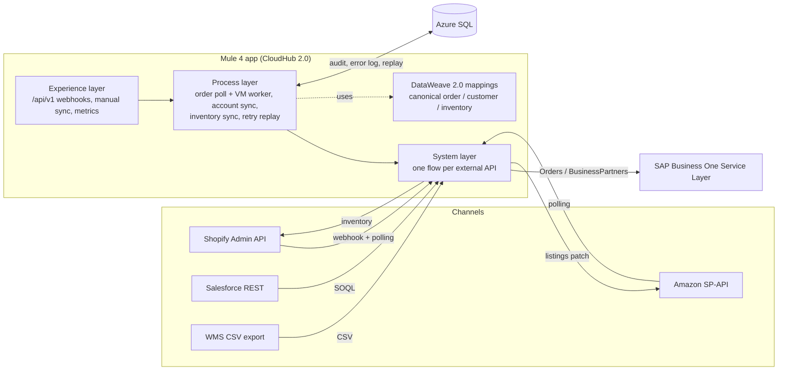

# Omnichannel Order & Inventory Integration Hub (MuleSoft + Azure)

An API-led MuleSoft integration that keeps a mid-size manufacturer's sales channels, CRM, warehouse and ERP in sync:

- **Orders:** Shopify and Amazon orders are normalized into one canonical model and created as SAP Business One sales orders, idempotently.
- **Customers:** Salesforce Accounts become SAP B1 Business Partners (create or update).
- **Inventory:** WMS stock levels (CSV export) are pushed to Shopify inventory levels and Amazon listings.
- **Reliability:** every sync is audited in **Azure SQL**; failures are logged with their payload and replayed with exponential backoff until they succeed or move to a dead-letter state.
- **Delivery:** MUnit tests and CloudHub 2.0 deployment run through **GitHub Actions**.

Local development needs no SaaS accounts: a FastAPI mock layer imitates all five external APIs, and SQL Server 2022 stands in for Azure SQL.

---

## Architecture



### API-led layers

| Layer | File | Responsibility |
|---|---|---|
| Experience | `exp-omnichannel-api.xml` | Shopify webhook (HMAC verified), manual sync triggers, success-rate metrics, error log browser. Contract in `api/omnichannel-hub-api.raml`. |
| Process | `prc-order-sync.xml` | Polls Shopify + Amazon, publishes canonical orders to a persistent VM queue; 4 workers create SAP orders with an idempotency check on `NumAtCard`. |
| Process | `prc-account-sync.xml` | Salesforce Accounts changed since the watermark → SAP Business Partner upsert. |
| Process | `prc-inventory-sync.xml` | WMS CSV → per-SKU availability → Shopify + Amazon. Full refresh, so failed SKUs self-heal next run. |
| Process | `prc-retry-replay.xml` | Claims due rows from `dbo.sync_error_log` and replays them. |
| System | `sys-ecommerce.xml`, `sys-sapb1.xml`, `sys-crm-wms.xml` | Auth (LWA, OAuth client credentials, SAP B1 session cookie) with token caching in Object Store, plus one flow per endpoint. |
| Shared | `error-handling.xml`, `global.xml` | HTTP error mapping, audit/error persistence, connector configs. |

### DataWeave mappings (`src/main/resources/dwl`)

| Script | From → To |
|---|---|
| `shopify-order-to-canonical.dwl` | Shopify order → CanonicalOrder |
| `amazon-order-to-canonical.dwl` | SP-API order + order items → CanonicalOrder (line totals → unit prices) |
| `canonical-to-sapb1-order.dwl` | CanonicalOrder → SAP B1 `Orders` (discount %, freight expense, channel CardCode) |
| `salesforce-account-to-canonical.dwl` | SOQL Account → CanonicalCustomer |
| `canonical-to-sapb1-bp.dwl` | CanonicalCustomer → SAP B1 `BusinessPartners` (15-char CardCode rule) |
| `wms-inventory-to-canonical.dwl` | WMS CSV rows → CanonicalInventory (summed across warehouses, never negative) |
| `canonical-to-shopify-inventory.dwl` | CanonicalInventory → `inventory_levels/set` bodies (SKU → inventory_item_id lookup) |
| `canonical-to-amazon-listing-patch.dwl` | CanonicalInventory → Listings Items API patch |

Shared helpers live in `modules/Utils.dwl` (SKU normalization, money rounding, dates, name splitting). The canonical order is validated against `schemas/canonical-order.schema.json` before it reaches SAP.

### Failure handling

| Failure | What happens |
|---|---|
| SAP 5xx / timeout | `until-successful` retries 3 times; then logged as retryable and replayed with backoff of 2^n minutes. |
| SAP session expired (401) | Cached session dropped, login repeated on the next retry. |
| SAP validation error (400) or schema violation | Logged once as `NON_RETRYABLE` with the full payload for a human to fix. No retry storm. |
| Same order seen twice (webhook + poll, or Shopify update) | Idempotency check finds the existing `NumAtCard` and records `SKIPPED_DUPLICATE`. |
| Replay keeps failing | After `max_retries` (default 5) the row becomes `DEAD_LETTER` (`GET /api/v1/errors?status=DEAD_LETTER`). |
| Several CloudHub replicas | `usp_claim_retryable_errors` uses `UPDLOCK, READPAST` so each row is replayed by one replica only. |

---

## Repository layout

```
omnichannel-integration-hub/
├── pom.xml, mule-artifact.json         Mule 4 app (runtime 4.6, Java 17)
├── src/main/mule/                      flows (exp / prc / sys / shared)
├── src/main/resources/
│   ├── dwl/, modules/Utils.dwl         DataWeave 2.0
│   ├── config/config-{local,cloud}.yaml
│   ├── api/omnichannel-hub-api.raml
│   └── schemas/canonical-order.schema.json
├── src/test/munit/                     MUnit suites (mappings + worker behaviour)
├── src/test/resources/test-data/       sample payloads for every source system
├── sql/azure-sql/                      tables, stored procedures, reporting views
├── mock-services/                      FastAPI mocks + contract tests
├── scripts/                            Azure SQL provisioning, local DB init, webhook load generator
├── docker-compose.yml                  mocks + SQL Server 2022
└── .github/workflows/ci-cd.yml         tests, SQL validation, Exchange publish, CloudHub 2.0 deploy
```

---

## Run it locally

**Prerequisites:** Docker, Anypoint Studio 7.x (or Maven 3.9 + a local Mule 4.6 EE runtime), Java 17, Python 3.10+.

1. **Start the mocks and database**
   ```bash
   docker compose up -d --build
   docker compose logs -f sql-init      # wait for "Database omnihub is ready."
   curl localhost:8090/health
   ```
2. **Run the Mule app**
   - Studio: *File → Import → Anypoint Studio project from File System*, pick this folder, then *Run As → Mule Application*. The default `env=local` loads `config-local.yaml`.
   - CLI: `mvn clean package` and drop `target/*.jar` into `$MULE_HOME/apps`.
3. **Watch it work.** Schedulers start immediately (orders every 2 min, inventory every 15, accounts every 30). Or trigger them:
   ```bash
   H='x-api-key: local-dev-api-key'
   curl -X POST -H "$H" localhost:8081/api/v1/sync/orders
   curl -X POST -H "$H" localhost:8081/api/v1/sync/inventory
   curl -X POST -H "$H" localhost:8081/api/v1/sync/accounts
   curl -H "$H" "localhost:8081/api/v1/metrics/sync?days=1"
   curl -H "$H" "localhost:8081/api/v1/errors?status=NON_RETRYABLE"
   curl localhost:8090/_mock/stats      # what the "external systems" received
   ```
4. **Push webhook load** (signed exactly like Shopify does):
   ```bash
   python scripts/send_shopify_webhooks.py --count 500 --rate 10
   ```

The mocks deliberately misbehave so the reliability paths get exercised: about 2% of SAP order posts return 503, about 1% of orders carry a SKU missing from the SAP item master, ~20% of Shopify SKUs arrive in lower case, and ~10% of polls re-send an already-synced order. Tune these in `docker-compose.yml`.

### Tests

```bash
mvn clean test                          # MUnit: mapping suite + order worker suite
pip install -r mock-services/requirements.txt && pytest -q mock-services/tests
```

MUnit covers the DataWeave mappings against the sample payloads plus three worker scenarios: new order created once, duplicate skipped, and SAP 400 logged without retrying.

---

## Deploy to Azure SQL + CloudHub 2.0

1. **Database**
   ```bash
   az login
   SQL_ADMIN_PASSWORD='...' APP_PASSWORD='...' ./scripts/provision_azure_sql.sh
   ```
   Creates a serverless General Purpose database (auto-pauses when idle), firewall rules, the schema, and a least-privilege `omnihub_app` user (EXECUTE on procs, SELECT on views). Paste the printed JDBC URL into `config-cloud.yaml`.

2. **Anypoint:** create a Connected App (client credentials) with *Exchange Contributor*, *Design Center Developer* and *Runtime Manager: Create/Read/Manage Applications* scopes on your environment.

3. **GitHub secrets**

   | Secret | Purpose |
   |---|---|
   | `ANYPOINT_ORG_ID`, `ANYPOINT_CLIENT_ID`, `ANYPOINT_CLIENT_SECRET` | Exchange publish + CloudHub 2.0 deploy |
   | `MULE_NEXUS_USERNAME`, `MULE_NEXUS_PASSWORD` | MuleSoft EE repo for MUnit |
   | `SHOPIFY_TOKEN`, `SHOPIFY_WEBHOOK_SECRET` | Shopify Admin API + webhook HMAC |
   | `AMAZON_CLIENT_SECRET`, `AMAZON_REFRESH_TOKEN` | SP-API Login with Amazon |
   | `SAPB1_PASSWORD`, `SALESFORCE_CLIENT_SECRET`, `WMS_API_KEY` | System credentials |
   | `AZURESQL_PASSWORD`, `HUB_API_KEY` | Database + experience API key |

   Optional repository variables: `ANYPOINT_ENVIRONMENT`, `ANYPOINT_TARGET`, `ANYPOINT_APP_NAME`.

4. **Push to `main`.** The workflow runs mock contract tests, applies the SQL scripts to a throwaway SQL Server and smoke-tests the procedures, runs MUnit, publishes `1.0.<run>` to Exchange, and deploys to CloudHub 2.0 with secrets passed as protected properties (hidden in Runtime Manager via `mule-artifact.json`).

5. **Register the Shopify webhook** (`orders/create`) pointing at `https://<app-url>/api/v1/webhooks/shopify/orders`.

---

## Measuring sync success

`dbo.vw_sync_success_rate_daily` counts an entity as succeeded if any attempt (first try or replay) synced it:

```sql
SELECT * FROM dbo.vw_sync_success_rate_daily ORDER BY sync_date DESC;
SELECT * FROM dbo.vw_order_sync_quality_daily;   -- first-pass vs eventual success
SELECT * FROM dbo.vw_open_sync_errors;            -- triage by error type
```

The same numbers are served by `GET /api/v1/metrics/sync`.

---

## Notes and next steps

- Connector and plugin versions in `pom.xml` were current when written; bump them to the latest on Anypoint Exchange before building.
- Shopify `orders.json` returns up to 250 orders per call and Salesforce up to 2,000 records; add cursor pagination (`Link` header / `nextRecordsUrl`) for higher volumes.
- Amazon `getOrderItems` is rate limited (0.5 rps, burst 30); a busy seller account needs throttling or the Reports API.
- Swap the HTTP-based Salesforce calls for the Salesforce Connector once a real org is attached, and front the experience API with an API Manager client-ID policy instead of the simple `x-api-key` check.
- SAP B1 user-defined fields (`U_SalesChannel`, `U_CustomerEmail`, `U_SalesforceId`, `U_Industry`) must exist in the target company database.
